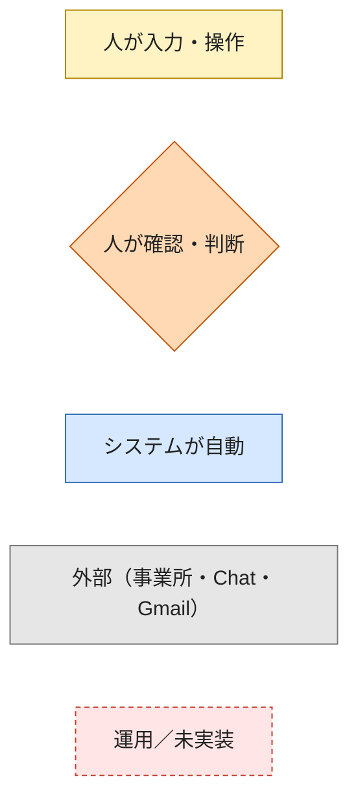
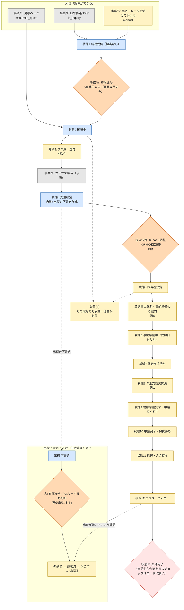
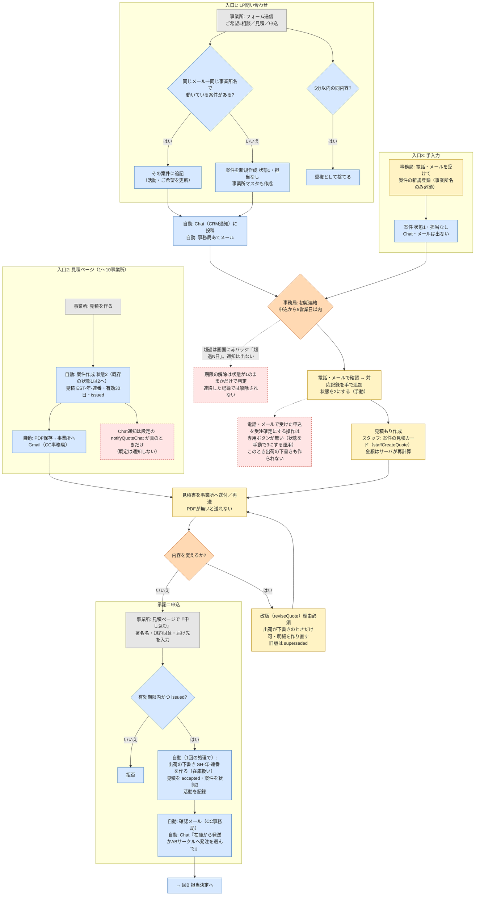
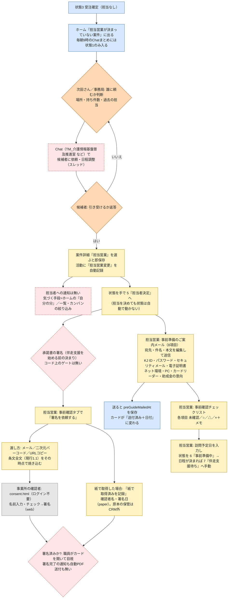
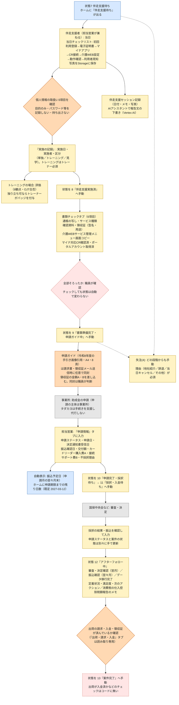
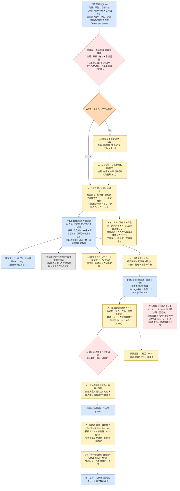
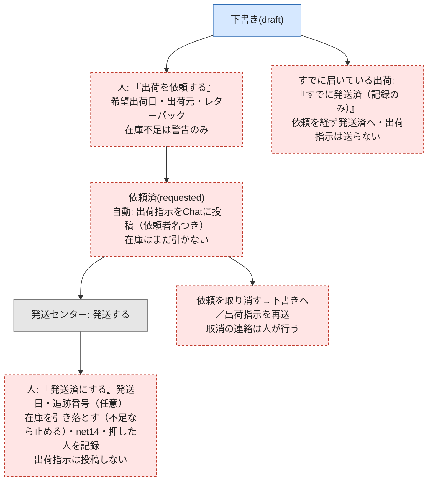
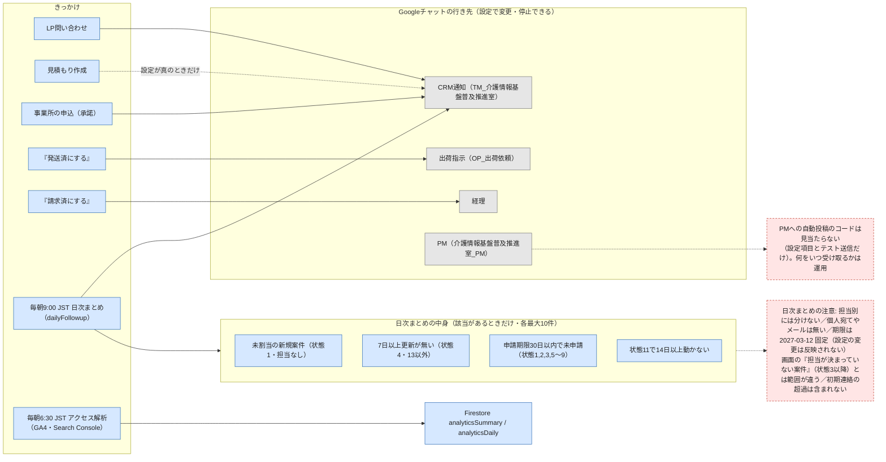
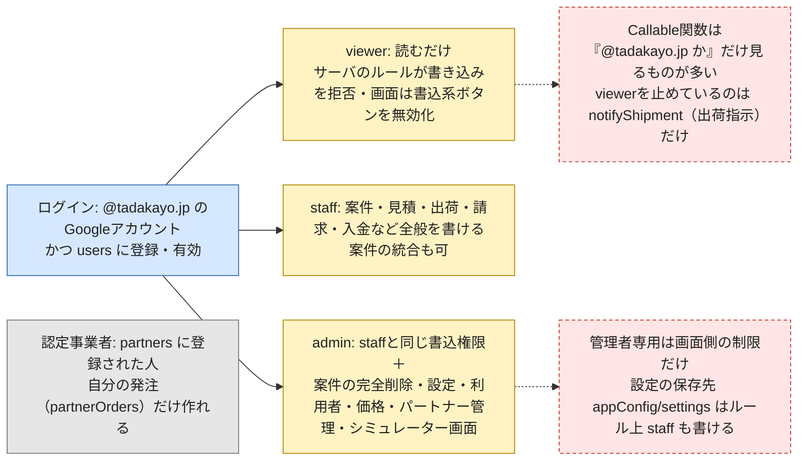

# 介護情報基盤CRM 業務フロー図（2026-10-21 現在のコードと運用）

**位置づけ**: CRM（`kjk-tadakayo`）の実装を読んで起こした「実際の動き」の図。正本はこの Markdown（Mermaid）。見やすい版は `CRM業務フロー図_20261021.html`。
**根拠**: functions/index.js・admin/js/*・firestore.rules・MANUAL.md・docs/出荷の二段階化_設計_20261020.md を読み取り（4分野を並行調査→突き合わせ）。コードに無い運用は「運用」と明記。**実装済みと未実装は区別**する。
**前提**: 出荷の二段階化（案B）は**未実装**。図Dの「現状」が今の動き、図D'が設計。

## 凡例（色と形）

| 見た目 | 意味 |
|---|---|
| 黄色の四角 | **人が入力・操作する** |
| 橙色のひし形 | **人が確認・判断する**（システムは止めない・強制しない） |
| 青色の四角 | **システムが自動でやる** |
| 灰色の四角 | 外部の人・サービス（事業所・Chat・Gmail・ABサークル） |
| 赤い点線の四角 | **コードに無い／運用に任されている／未実装**（人の記憶と声かけが頼り） |

---

## 図0. 全体（受付から案件完了まで）

案件のステータス（1〜13）を背骨に、並行して動く「出荷・請求・入金」の流れを右に置く。

**全体の注意（コードで確認できたこと）**
- ステータスの移動は**ほぼすべて手動**。順序制限も前提条件のチェックも無い（任意の状態へ動かせる）。**自動で動くのは 1→2（見積作成）と →3（事業所の申込）だけ**。
- 案件ステータス・申請ステータス（subsidyApplications）・出荷の状態（shipments）は**互いに連動しない**。
- 担当を自動で割り当てる処理は、どの入口にも無い（案件は必ず担当なしで作られる）。

---

## 図A. 入口〜見積もり〜申込（受注確定）

---

## 図B. 担当決定〜承諾書〜事前準備

実際の運用では、担当は**Googleチャットでお願い・調整してから**CRMに入れている。CRMは担当に何も通知しない。

---

## 図C. 伴走支援（当日）〜書類〜申請〜採択〜アフター〜完了

---

## 図D. 出荷・請求・入金・領収（現状＝実装済み）

### 図D'. 設計（案B・**未実装**）— 「出荷を依頼する」と「発送済にする」を分ける

---

## 図E. 毎日・随時の自動処理と通知の行き先

---

## 図F. 権限（誰が何をできるか）

---

## 人が確認・判断する点の一覧（ここが抜けると止まる）

| 工程 | 誰が | 何を確認・判断するか | システムの強制 |
|---|---|---|---|
| 受付 | 事務局 | 初期連絡（5営業日）／重複／既存案件への追記 | 画面の赤バッジのみ。通知なし。連絡の記録では解除されない |
| 受注確定（電話・メール申込） | 事務局 | 申込を受けたら状態を3にする | 専用ボタンなし。出荷の下書きも作られない |
| 担当決定 | 次田さん／事務局 | 誰に頼むか。Chatで依頼・調整→CRMの担当欄 | 担当は自動割り当て無し。担当への通知なし |
| 承諾書 | 担当営業 | 署名が済んだか（目視）。伴走支援の前に取る | 状態を進めるゲートなし。署名完了の通知なし |
| 出荷の下書き | 事務局・供給担当 | 在庫から／ABサークルの判断。住所・数量・送料 | 判断基準はコードに無い |
| 発送済にする | 事務局・供給担当 | 実際に発送されたか | 押した瞬間に在庫引落しとChat投稿が走る（案B未実装） |
| 請求 | 事務局・経理 | 発行日・経理への報告・メール送付 | 失敗しても請求済の記録は残る |
| 入金 | 事務局・経理 | 通帳との照合。金額・日付の入力 | 自動突合なし |
| 領収証 | 事務局・経理 | 明細・用途区分（A/B/X） | 警告のみ。止めない |
| 書類・申請 | 担当営業 | 6項目の書類がそろったか。申請ガイドを同封するか | 状態は自動で動かない |
| 案件完了 | 担当営業・管理者 | 出荷が入金済か。アフター終了か | チェックなし |

## 図の限界（未確認として残した点）
- 見積の `expired`（期限切れ）に自動で変える処理は見当たらない（画面の「期限切れ」表示のみ）。
- 事業所マスタ（offices）は表示専用で、手で編集する画面は見つからなかった。
- 認定事業者側の「納品確認」画面はコードに無い。
- 支払期限の説明が文書で食い違っている（図Dの注記）。どちらが現行かは次田さんの確認待ち。
- `SHIP_STATUS_JA`（case-detail.js）の中身と、見積承諾ページ（mitsumori.html）の画面の細部は読んでいない。
- 運用（チャットでの担当調整など）は、この会話で読んだ範囲。台帳 §N と整合させて更新すること。
