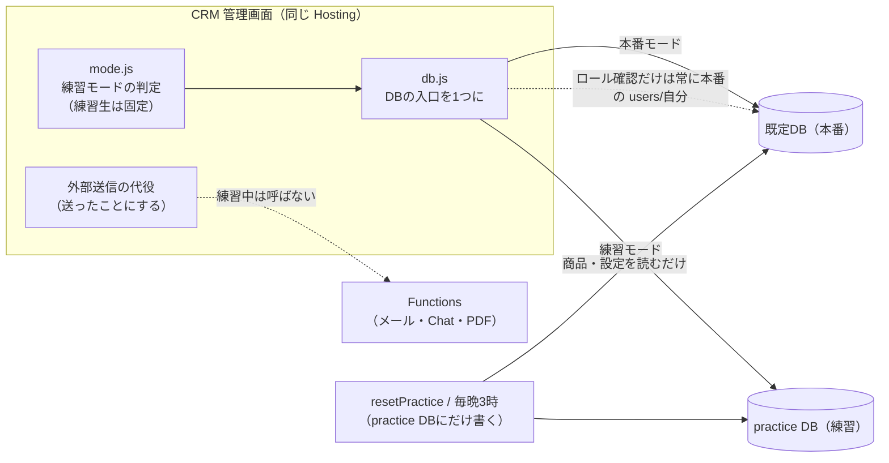

# CRM 学習用テストモード 設計書（2026-10-20）

> 依頼: 次田さん（2026-10-20）／根拠: 10/19 PM打ち合わせ 議事録 T034「検証用の仮ユーザー・練習エリア（ログアウトでリセット）」／計画書 `06_介護情報基盤事業/組織体制_素案_20261018/CRM改修計画_20261019.md` #11
> 状態: **実装済み（ブランチ `crm-test-mode`・未コミット）**。GCP 操作・本番反映は未実施（§5 の順に1つずつ承認をもらう）

## 1. 決まったこと（次田さんの決定・蒸し返さない）

| 項目 | 決定 |
|---|---|
| 方式 | **案C**：同じプロジェクト kjk-tadakayo に、練習専用の Firestore データベース `practice` を作る |
| 練習できる範囲 | **全画面**（案件・対応記録・出荷・請求・入金・見積）。外部送信は「送ったことにする」 |
| 使える人 | 職員は全員が切替で入れる。新人には **「練習生」ロール**＝練習モード固定・**本番は読み書きとも不可** |
| リセット | ①ログアウト時に**自分が作った分**を削除 ②**毎晩3時**に練習場全体を初期データへ ③管理者の**「今すぐ初期化」** |
| 架空データ | 事業所12・案件12・対応記録・見積3・出荷4・認定事業者1。商品・料金は本番から写す。設定は**外部送信先を除いて**写す。練習生には「あなたの担当」2件 |

## 2. 方式の比較（記録）

| | 案A 同じDBに `practice_…` コレクション | 案B 別プロジェクト | **案C 同じプロジェクトに別DB（採用）** |
|---|---|---|---|
| 作業量 | 大（約200か所の参照を書き換え） | 中〜大（プロジェクト・認証・Secret・デプロイ手順を一式） | **中**（DBにつなぐ23か所を1部品にまとめるだけ） |
| 本番を壊す危険 | 参照漏れ1か所で本番に書く | 最小（物理分離） | **小**（DBが別・Functions は練習DBを見ない・練習生は本番ルールで拒否） |
| 費用 | ほぼ0 | 別の Blaze・最低限の固定費 | **月数円〜数十円**（無料枠は既定DBのみ） |
| 運用 | 少 | 2環境のデプロイを毎回 | **少**（同じ Hosting・同じログイン） |

## 3. 仕組み

### 3.1 画面側
- **`admin/js/db.js`**：`getFirestore(app)` を直接呼んでいる23か所をこれに置き換える。練習モードなら `getFirestore(app, "practice")` を返す。ロール確認（`users/自分`）だけは常に本番DBを読む。
- **`admin/js/mode.js`**：練習モードの判定。練習生は常に練習。ほかの職員はサイドバーの「練習モード」切替（ブラウザに覚える・全タブ共通・切り替えたら再読み込み）。練習中は画面上部に黄色の帯「練習モード：本番のデータではありません」を常に出す。
- **作成者の記録**：Firestore の書き込み関数（addDoc・setDoc・batch.set）を `admin/js/fs.js` 経由にして、練習DBへの新規作成にだけ `_practiceBy: メール` を付ける（本番DBには付けない）。ログアウト時の「自分が作った分の削除」に使う。
- **外部送信の代役**：練習中は `httpsCallable` を作らず、代役が成功と同じ記録（例：出荷指示の投稿日時・メール送付日）を練習DBに書いて「練習のため送信していません」と出す。対象12個：aiAssist・sendCaseEmail・sendSupplierOrder・sendPartnerMail・reportInvoiceToAccounting・notifyShipment・testChatNotify・resendQuoteMail・reviseQuote・staffCreateQuote・saveQuotePdf・collectAnalyticsNow。
  - **見積の作成・改版**は今は Functions が計算して保存しているので、練習中は画面側の `estimate-pricing.js`（Functions と同じ計算）で練習DBに保存する。PDF は画面の表示・印刷で練習できる（Storage には保存しない）。
- **写真の保存**（訪問写真・追跡番号のシール）：練習中は Storage に上げず「練習のため保存しません」。
- **練習生の「あなたの担当」2件**：練習モードに入ったとき、自分の担当の案件が無ければ、2件を自分の作成として作る（ログアウトで消える＝次に入ればまた作られる）。

### 3.2 ルール
- **本番DB（firestore.rules）**：`role == "trainee"`（練習生）を `isRegistered()` から外す。練習生が本番で読めるのは自分の `users` だけ（ロール確認のため）。画面の漏れがあっても本番は読めず・書けない。
- **練習DB（firestore.practice.rules を新設）**：@tadakayo.jp のログインなら読み書き可（中身は架空データのみ。別DBの users を見に行けないため）。`users` コレクションは練習DBに置かない。
- **Storage**：練習中は画面で止める（st.js）。加えて、練習生は職員向けファイル（訪問写真・報告書・書類・請求書／見積PDF・追跡番号の写真）を**読めない・書けない**（storage.rules。動画マニュアル training/ は練習生も見られる）。

### 3.3 Functions（新設2つ・既存は変えない）
- `resetPractice`（callable・**管理者のみ**）：練習DBを空にして初期データを入れ直す。商品・料金・設定は本番から読んで写す（設定は Chat の投稿先4種・メールの送り先・印影を除く）。
- `nightlyPracticeReset`（毎日 3:00 JST）：同じ処理。
- どちらも `getFirestore("practice")` にだけ書く。本番DBへの書き込みは作らない（コードとテストで確認）。

### 3.4 架空データ（`functions/practice-seed.js`）
- 事業所12：名前の頭に「【練習】」。都道府県・市区町村は実在、番地は架空、電話 000-0000-0000、メール example.jp。
- 案件12：新規受信3・準備2・伴走支援2・申請〜採択2・完了1・失注1・止まっている案件1。担当は未割当／「練習 太郎」／「練習 花子」（架空のアドレス `practice-…@example.jp`）。
- 対応記録：案件ごとに1〜3件。見積3：1事業所・同一法人で複数事業所・改版済み。出荷4：下書き・発送済・請求済・入金済。認定事業者1：架空。
- 本番の人・事業所の名前は一切使わない。

### 3.5 ユーザー管理
- ロールの選択肢に「練習生（本番は見られない）」を足す。独り立ちしたら管理者が「スタッフ」に変える。

## 4. 作業量の目安

| 作業 | 目安 |
|---|---|
| db.js・fs.js・mode.js と23画面の置き換え、帯・切替・ロール | 1.5日 |
| 外部送信の代役12個（見積の画面側保存を含む） | 1.5日 |
| 架空データ・初期化の Functions・ログアウト削除 | 1日 |
| ルール（本番・練習）とテスト | 0.5日 |
| 検証（エミュレータでのルールテスト・画面の通し確認）・Codex レビュー・記録 | 1日 |
| **合計** | **約5.5日** |

## 5. 承認が要る操作（実装のあと、内容を示して1つずつ）

1. 練習DBの作成：`gcloud firestore databases create --database=practice --location=<既定DBと同じ> --project=kjk-tadakayo`（課金：月数円〜数十円の見込み）
2. ルールの反映：本番DB（練習生の拒否を追加）と練習DB（新設）
3. Functions の反映：新設2つ（`resetPractice`・`nightlyPracticeReset`）＋**練習生を拒否するようにした既存の11個**（reviseQuote・resendQuoteMail・staffCreateQuote・saveQuotePdf・testChatNotify・sendCaseEmail・sendSupplierOrder・sendPartnerMail・reportInvoiceToAccounting・notifyShipment・collectAnalyticsNow）。`--only` に13個を列挙する（aiAssist は変更なし）
4. 初回の初期化（`resetPractice` を1回実行）
5. 管理画面（admin Hosting）の本番反映

## 6. 危険と手当て

| 危険 | 手当て |
|---|---|
| 練習中に本番DBへ書く（DBの入口の漏れ） | 入口を db.js の1か所に。`getFirestore(` の直接呼び出しが残っていないことをテストで検査（grep） |
| 練習中にメール・Chat が飛ぶ | 練習中は Functions の呼び出し口そのものを作らない。12個すべてを代役に置き換えたことをテストで検査 |
| 練習生が本番を見る | 本番ルールで拒否（画面に頼らない）。エミュレータでルールテスト |
| ログアウトで他人の練習データを消す | 削除は `_practiceBy == 自分` のものだけ。初期データには付けない |
| 毎晩の初期化が本番を消す | 初期化の Functions は `getFirestore("practice")` 以外に書かない。コード上で検査 |

## 7. 実装の記録（2026-10-20）

| 部品 | ファイル |
|---|---|
| Firestore の入口（練習なら practice・新規作成に `_practiceBy`） | `admin/js/fs.js`（各画面の import 先を CDN からここへ。`getFirestore(app)` は書き換えない） |
| モード・帯・切替・ログアウト時の片付け・「あなたの担当」2件 | `admin/js/mode.js`（`role.js` の `gateRole` から `setupModeUi` を呼ぶ） |
| Functions の入口・代役12個 | `admin/js/fn.js`・`admin/js/practice-stubs.js`（代役の無い呼び出しは止める） |
| Storage の入口（練習中は保存しない） | `admin/js/st.js` |
| 本番DBのまま使うもの | `role.js`・`auth.js`（users）・`users.js`／`badges.js`／ホームの onboarding（`getProdFirestore`）・`consent-sign.js`（署名ページ）・`partner.js`（認定事業者ポータル） |
| 初期データ・初期化 | `functions/practice-seed.js`・`functions/practice.js`（`resetPractice`・`nightlyPracticeReset`） |
| ルール | `firestore.rules`（`isRegistered` に `role != 'trainee'`）・`firestore.practice.rules`（新設）・`storage.rules`・`firebase.json`（firestore を2DBの配列に） |
| 管理者の「今すぐ初期化」 | 設定画面の最下部（`settings.js` の `resetPractice` だけ本物の Functions を呼ぶ） |
| テスト | `test-practice-mode.mjs`（漏れ検査 47）・`test-practice-seed.mjs`（368）・`test-rules.mjs`（エミュレータ 111） |

設計からの変更・補足:
- 見積は**5件**（3つの場面＝単独・同一法人2事業所・改版2版を表すため）。
- ログアウトしたら練習モードの記憶も消す（次にそのブラウザでログインする人は本番から。練習生はログイン後に練習へ戻される）。
- 練習中の担当営業の候補は「自分・練習 太郎・練習 花子」（本番の職員名簿は練習に出さない）。
- 練習中に「送ったことにした」内容は練習DBの `practiceSent` に控えを残す（ふり返り用・初期化で消える）。
- 練習中に作った署名依頼のURLには `&p=1` を付け、署名ページは練習DBを読む（練習DBはログインが要るので、同じブラウザでログインしている職員だけが開ける。帯「練習モードの署名ページです」）。
- **Codex レビュー1回目の指摘（4件）を反映**: ①本番の Callable 12個すべてで練習生を拒否（`rejectTrainee`。Admin SDK はルールを迂回するため、画面の差し替えだけでは足りない）②merge で新しく作られる文書にも作成者を付ける（setDoc・batch とも、存在を確かめてから）③練習の署名依頼を開ける ④モードは localStorage を正とし、使えない環境だけ sessionStorage（別タブの「本番に戻る」が効かなかった）。
- **Codex レビュー2回目（3件）**: 認定事業者向け料金・送料（partnerPricing・letterpackFee・yupackTable）を数値の構造だけ写す／setDoc・batch.set は書く前に有無と元の作成者を読み、上書きでも作成者を変えない／「あなたの担当」は毎回あるかを確かめる（初期化で消えたあとも作り直す）。
- **Codex レビュー3回目（3件）**: aiAssist は練習生の拒否から外す（実行SA fn-ai-sa は aiplatform.user のみで Firestore を読めない＝権限を増やさない。AI は画面から渡された文章を扱うだけで本番データに触れない）／練習DBの設定に架空の経理担当（keiri-renshu@example.jp）を入れて経理報告を練習できるように／ログアウト時の片付けは表示中のモードに関係なく行う。
- **Codex レビュー4回目（1件）**: 本番の保管場所・商品をそのまま写すと届け先の氏名・住所・電話・作成者が練習DB（練習生も読める）に入る → 保管場所は ID・都道府県・既定・並びだけ残して架空の届け先に、商品は作成者・メール・電話・URL入りの値を落として写す（`sanitizeLocation`・`sanitizeProduct`）。
